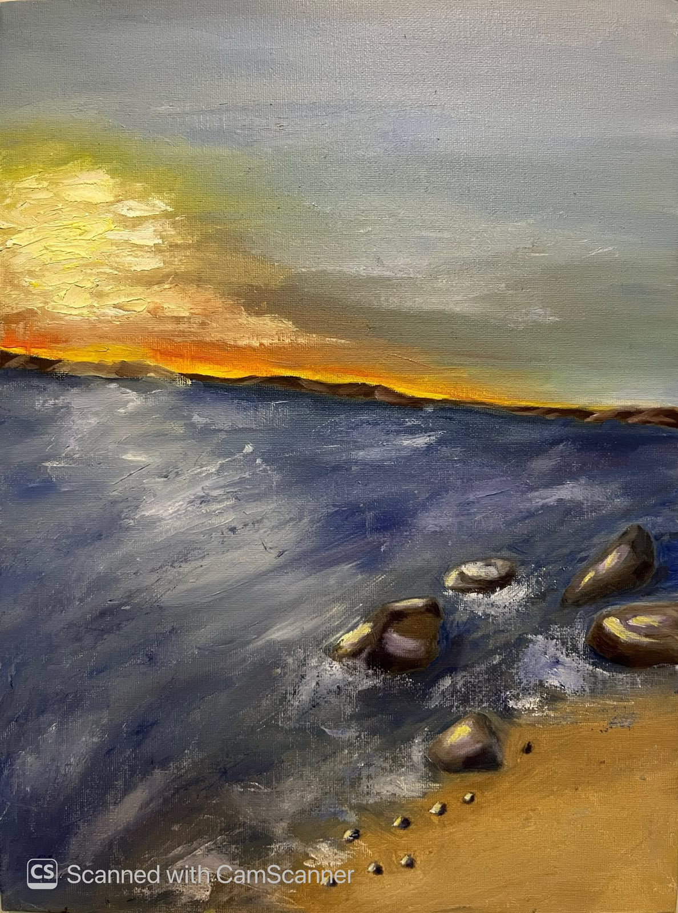
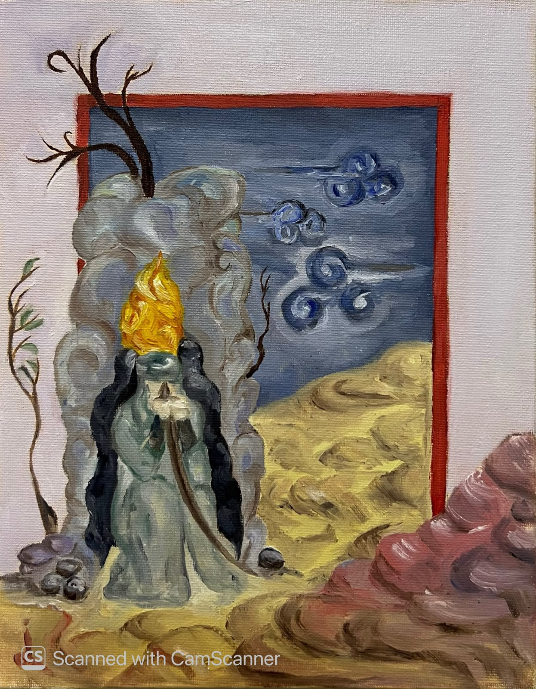
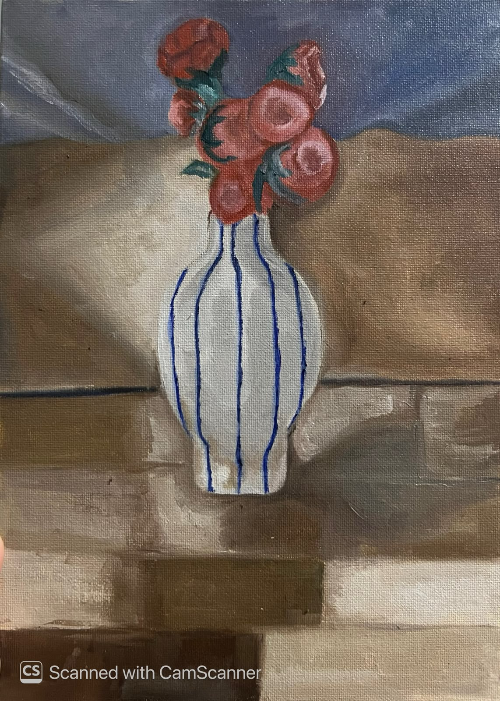
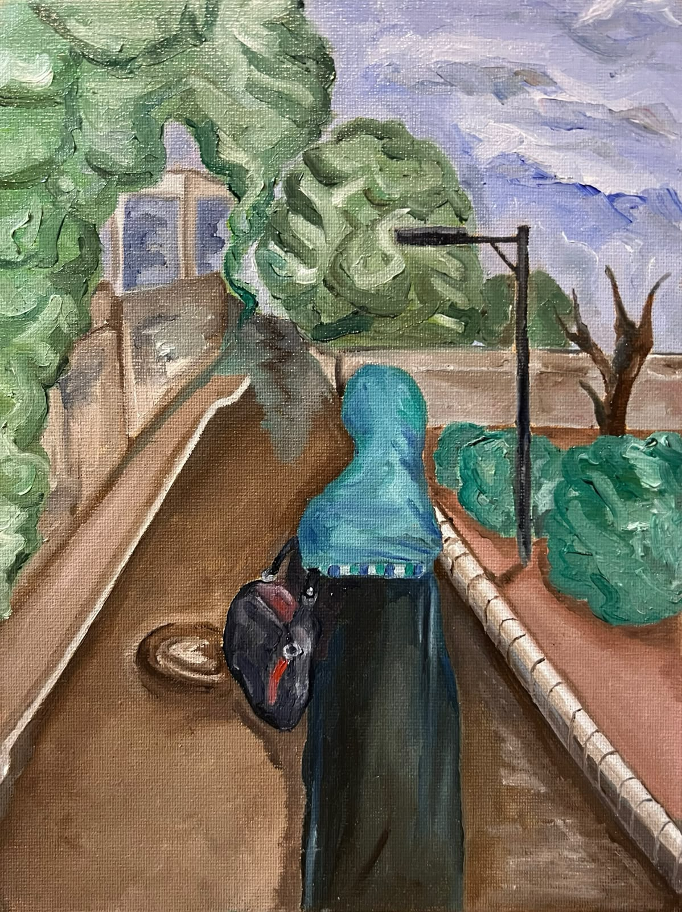

# 🎨 Art Gallery System

A desktop art gallery application built with **Java**, **JavaFX** and **FXML**, following the **Model–View–Controller (MVC)** design pattern.

This project was developed as a group project for the **CS4108 – Advanced Programming** course. It brings together the main topics of the course: GUI design, event-driven programming, MVC, file persistence, functional programming with lambdas and streams, and input validation.


---

## 🖼️ A Gallery of Real Artworks

What makes this project personal is that **every artwork in the gallery is an original painting by our team member Joud Saleh**. Instead of using stock images or placeholder pictures, she added her own oil and pastel works to the application, so the gallery shows real art with its own story.

Each artwork comes with a short description written by the artist, telling the moment or the idea behind the painting.

### Oil Paintings

<table>
  <tr>
    <td align="center" width="25%">
      <br>
      <b>Thuwal Beach</b><br>2023
    </td>
    <td align="center" width="25%">
      <br>
      <b>A Quiet Escape</b><br>2026
    </td>
    <td align="center" width="25%">
      <br>
      <b>My Friend's Vase</b><br>2026
    </td>
    <td align="center" width="25%">
      <br>
      <b>Too Many Paths</b><br>2026
    </td>
  </tr>
</table>

### Pastel Paintings

<table>
  <tr>
    <td align="center" width="50%">
      <br>
      <b>Cat's Adventures</b><br>2024
    </td>
    <td align="center" width="50%">
      <br>
      <b>The Sleepy Grey</b><br>2024
    </td>
  </tr>
</table>

> © Joud Saleh. The artworks in this repository are included for this academic project only and may not be copied, reused or redistributed without the artist's permission.

---

## ✨ Features

- Browse all artworks in a clean, visual gallery.
- Filter by category: **Oil Paintings** or **Pastel Paintings**.
- Live search by title or artist while typing.
- Sort artworks by title or by year.
- Open any artwork to see it in a large view with its title, artist, year, category and description.
- Register and log in as a user.
- Like, rate (1–5 stars) and comment on artworks.
- See your own activity: your comments, liked artworks and ratings.
- View simple gallery statistics, such as artworks per category and the most-liked artworks.
- All user interactions are saved to local files, so they are still there after the app restarts.

Artworks are added only by the developers. Regular users can view and interact with the artworks but cannot upload or edit them.

---

## 🧰 Technologies

- **Java 17+**
- **JavaFX 21** with **FXML** (designed in Scene Builder)
- **CSS** for styling
- **Maven** for building and running
- Plain **text files** for data storage (no database)

---

## 🗂️ Project Structure

```
src/main/java/com/artgallery/
├── model/        Artwork, ArtworkCategory, User, Comment, Like, Rating
├── controller/   One controller per screen
├── service/      Business logic, searching, sorting and statistics
├── repository/   Reading and writing the data files
└── util/         Navigation, validation, alerts, images and session
src/main/resources/com/artgallery/
├── view/         FXML screens
├── css/          Stylesheet
└── images/       oil/ and pastel/ artwork images
data/             artworks.txt, users.txt, comments.txt, likes.txt, ratings.txt
```

---


## 👩‍💻 Team

This project was built by a team of four students:

| Member | GitHub |
|---|---|
| **Joud Saleh** | [JousSaleh](https://github.com/JousSaleh) |
| **Refal** | [refal-Aloufi](https://github.com/refal-Aloufi) |
| **Walaa** | [lixqvll](https://github.com/lixqvll) |
| **Lamees** | [LAlreb](https://github.com/LAlreb) |
